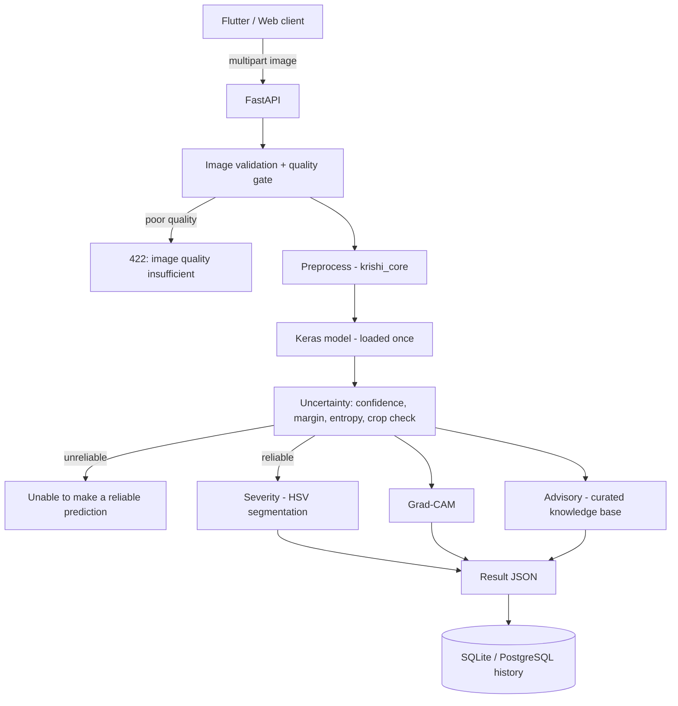
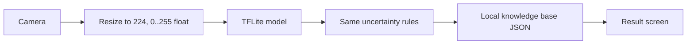

# Architecture

## Key design decisions
| Decision | Reason |
|---|---|
| Normalisation inside the model graph | the same graph is exported to TFLite; removes a major train/serve skew source |
| `core/krishi_core` shared package | preprocessing, quality, uncertainty, severity, Grad-CAM exist exactly once |
| Grad-CAM on pre-softmax logits | softmax gradients vanish at ~100% confidence |
| Advisory from a curated JSON, never a generative model | no invented pesticide names/doses |
| Model mounted into Docker, not baked in | small image, swappable model versions |
| Image re-encoded on upload | strips EXIF/GPS metadata |
| 503 if model missing, server still boots | graceful failure; mobile falls back to offline model |

## Backend layout
`backend/app/{api,config,database,schemas,services,data}` - routes only handle HTTP; services hold logic (`ModelService`, `ImageService`, `SeverityService`, `ExplainService`, `AdvisoryService`, `HistoryService`).

## API summary
`GET /api/health` - `GET /api/crops` - `GET /api/crops/{crop}/diseases` - `POST /api/predict` (image, crop?, language, explain) - `GET /api/predictions` - `GET /api/predictions/{id}` - `DELETE /api/predictions/{id}` - `GET /api/diseases/{class_id}` - `GET /api/advisory/{class_id}`.
(`/api/predict/advanced` from the brief is merged into `/api/predict`, which already returns severity + Grad-CAM; pass `explain=false` to skip the heatmap.)
